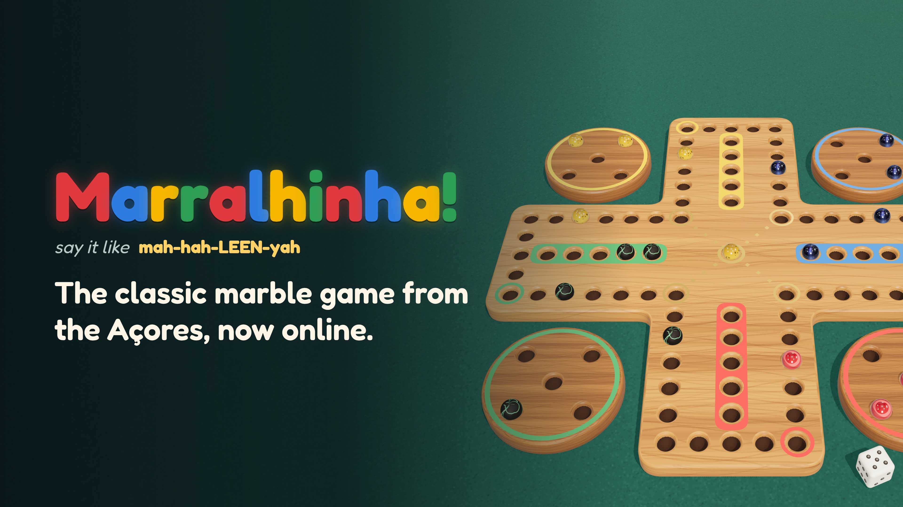
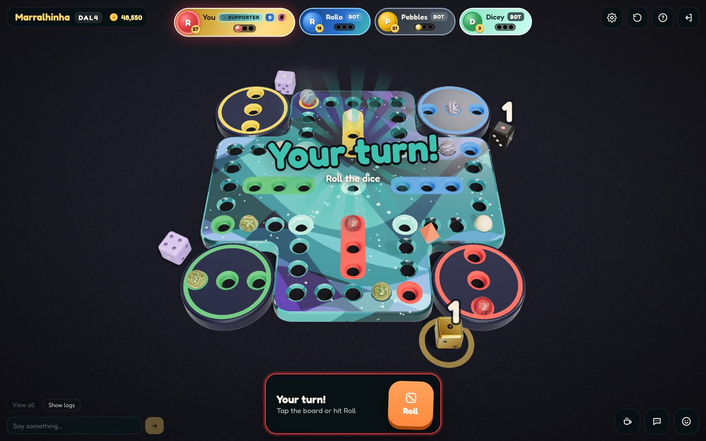
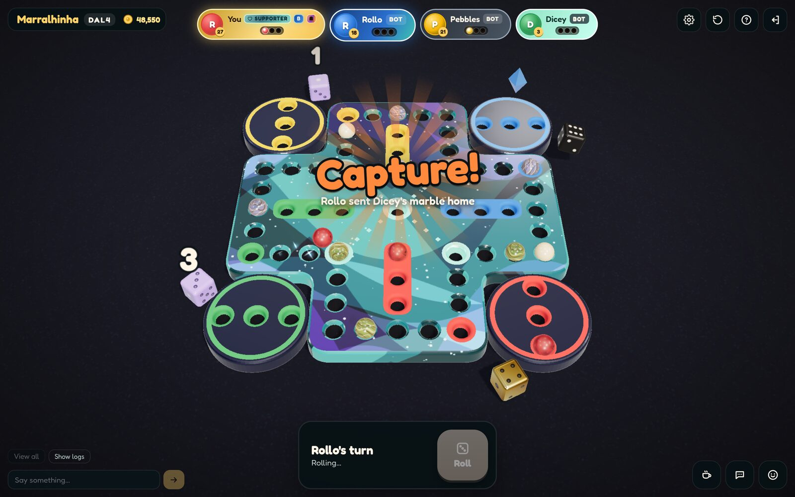
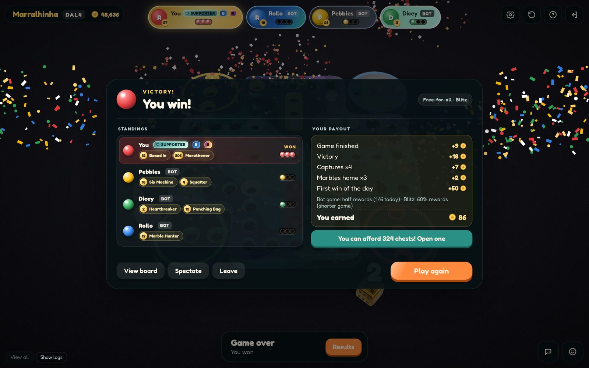
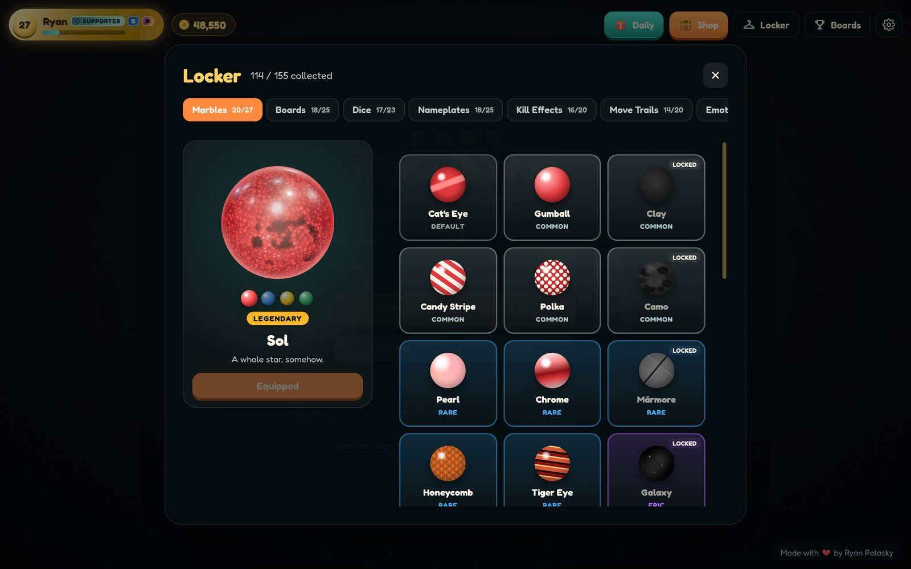
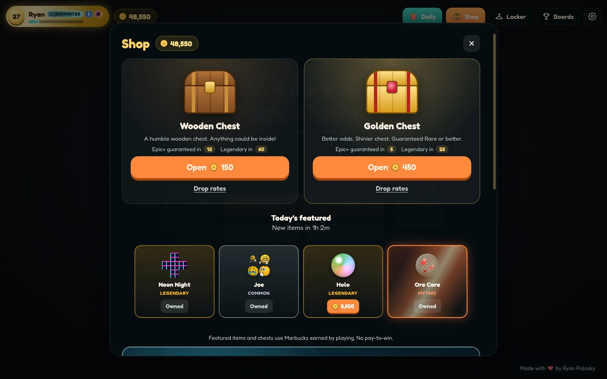
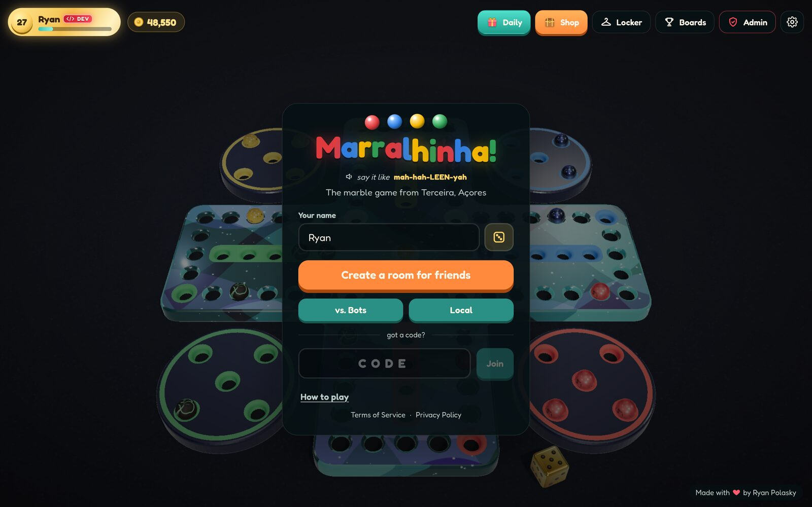
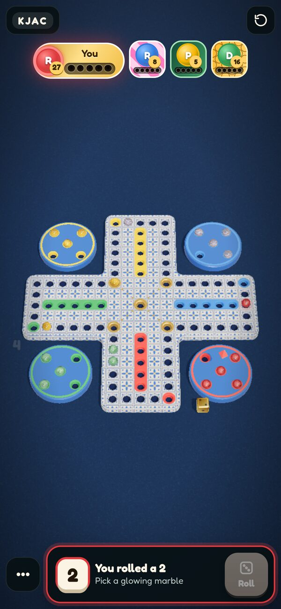
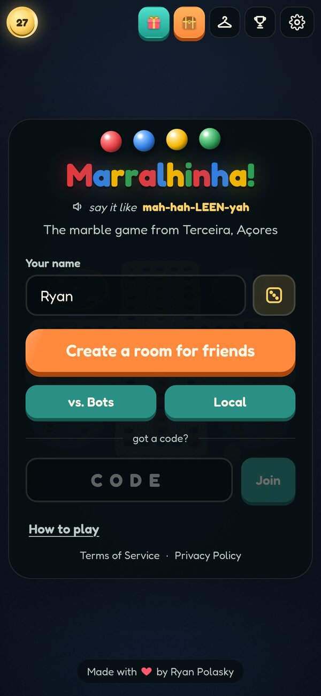

  

  <b>The marble game from Terceira, Açores. Now online, free, and one link away.</b> 
  2–4 players · friends or bots · browser, phone, or right inside Discord

  
  

  

Marralhinha (say it like "mah-hah-LEEN-yah") is what Terceira plays at the kitchen table: race your marbles around the cross, knock your friends back to their dish, and gamble on the shortcut through the center. It's easy enough to learn in one game and mean enough to start arguments in the second.

## Why you'll like it

- **No download, no signup.** Open [marralhinha.app](https://marralhinha.app) and you're already holding dice. Everyone gets a guest account instantly.
- **Bring your people.** Share a four-letter room code, or launch it as a **Discord Activity** and everyone in the voice channel lands at the same table.
- **Never short a player.** Bots fill empty seats, cover anyone who drops, and play your turns while you grab a snack.
- **Plays great on a phone.** Same game, same rooms, desktop and mobile at one table.
- **Looks good, plays fair.** Unlock marbles, boards, dice, nameplates, kill effects, move trails and emotes. All of it is cosmetic; nothing you can buy changes the game.

## Pick your poison

| **Classic** | **Blitz** | **2v2 Teams** |
| --- | --- | --- |
| Five marbles on the full board. The real deal, full rewards. | Three marbles on a smaller board, about a third of the time. | Partners sit opposite, can't capture each other, and finish each other's runs. |

Playing on one device? **Local** mode passes the dice around the couch.

## Screens

<table>
  <tr>
    <td width="50%"> <b>Send them home.</b> Land on a marble and it goes right back to its dish.</td>
    <td width="50%"> <b>Win loud.</b> Confetti, Marbucks, and awards for whoever got bullied the most.</td>
  </tr>
  <tr>
    <td width="50%"> <b>Show off.</b> 150+ marbles, boards, dice, nameplates, kill effects, trails and emotes to collect.</td>
    <td width="50%"> <b>Crack chests.</b> Earn Marbucks by playing, then roll for something shiny.</td>
  </tr>
  <tr>
    <td width="50%"> <b>Jump in.</b> Make a room for friends, fight the bots, or pass the dice around the couch.</td>
    <td width="50%" align="center">  <b>Pocket-sized.</b> Built for touch from the start.</td>
  </tr>
</table>

## How it plays

1. **Get out.** Roll a 1 or a 6 to move a marble from your dish onto the board.
2. **Race.** Run every marble around the cross and into your colored home column. First to bring them all home wins.
3. **Roll a 6, roll again.** Anything else and the turn passes.
4. **Capture.** Land on an opponent and send them back to their dish.
5. **Take the shortcut.** From a brass corner (except the last one before your home), a 1 or 6 drops you into the center. Another 1 or 6 jumps you out to the corner right by your home.
6. **Finish exact.** In the home column you need the exact roll. No overshooting, no hopping your own marbles.

**Controls:** Space rolls, Tab then Enter picks a move. Drag to spin the board, scroll to zoom, and ping a spot with H (G warns teammates) or right-click / long-press. The full illustrated rules live under the **?** button in game.

## Progression

Play games to earn **Marbucks**, claim a daily reward, and spend them on chests and the rotating featured shop. Your profile tracks match history, stats and a player card, and the leaderboards keep score. Link Discord to carry your progress across devices.

Want to chip in for the server? The one-time **Supporter Pack** adds a badge and exclusive cosmetics, and the seasonal **Halloween Pack** is sold only in October. Only the look changes, never the gameplay. Marbucks can't be bought.

---

  <a href="https://marralhinha.app"><b>Play Marralhinha</b></a> ·
  <a href="https://discord.gg/T4Efqprrd8">Discord</a> ·
  <a href="TERMS.md">Terms</a> ·
  <a href="PRIVACY.md">Privacy</a> 
  Made with ❤️ by <a href="https://github.com/ryanpolasky">Ryan Polasky</a>

